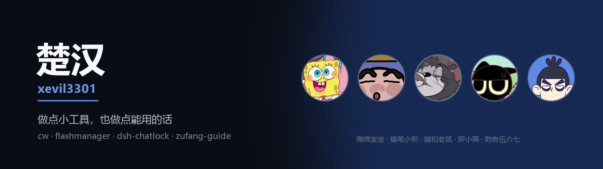

<div align="center">
  
</div>

<div align="center">
  <a href="https://github.com/xevil3301/cw"></a>
  
  
  
</div>

<br>

<table>
<tr>
<td width="50%" valign="top">

### [cw · 楚乌](https://github.com/xevil3301/cw)

带场景来，拿方案走的谋略工具。

不是「你要学会沟通」这种话，是一句能直接发出去的话，和几步今天就能做的动作。

61 篇，12.9 万字，每条结论都标了证据等级。


</td>
<td width="50%" valign="top">

### [flashmanager](https://github.com/xevil3301/flashmanager)

本地 Flash 游戏库管理器。

扫盘、入库、一键启动，把那个年代的 swf 从收藏夹里捡回来，塞进一个能用的界面。

Electron + React，离线优先。


</td>
</tr>
<tr>
<td width="50%" valign="top">

### [dsh-chatlock](https://github.com/xevil3301/dsh-chatlock)

DeepSeek Harness 的聊天锁与保险箱。

给单个会话上密码锁，打开时遮罩验密；再把一个目录整体做成 AES-256-GCM 密文，锁定后磁盘上只剩 `.bin`，连文件名都读不出来。


</td>
<td width="50%" valign="top">

### [zufang-guide](https://github.com/xevil3301/zufang-guide)

租房前帮你问对问题，出事时告诉你找谁。

18 张能力卡，按场景拆。押金怎么谈、合同哪几条要改、被拖着不修该找哪儿，都写成能直接照做的步骤。


</td>
</tr>
</table>

---

### 正在做

把 DSH 的插件生态摸一遍。上游的 [dsh-m](https://github.com/xevil3301/dsh-m) 和 [awesome-dsh-plugin](https://github.com/xevil3301/awesome-dsh-plugin) 都 fork 了一份在读代码，自己写的插件在往市场里送。

### 怎么装这些东西

它们大多不是「下载安装包」那一类。把仓库地址丢给 agent 就行。

```text
帮我安装这个项目，github 地址是 github.com/xevil3301/<项目名>
```

<div align="center">
<sub>有些事讲道理没用，撕破脸又不值。这类事的答案不在情绪里，在结构里。</sub>
</div>
